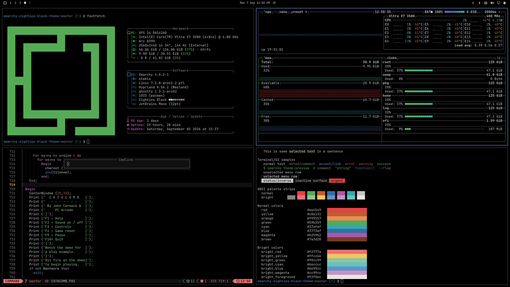
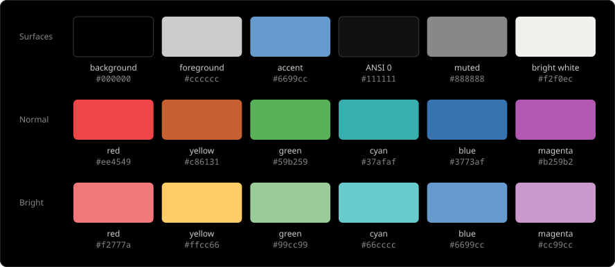

# Eighties Black

Omarchy theme. [Chris Kempson](http://chriskempson.com)'s Eighties palette on true black (`#000000`).



## Install

```bash
omarchy theme install https://github.com/j-c-m/omarchy-eighties-black-theme.git
rm -rf ~/.config/omarchy/themes/eighties-black/.git
omarchy theme set eighties-black
```

Omarchy rebuilds an installed theme that still has a `.git` directory from `colors.toml`. Removing it and setting the theme again applies this repo. Installing the URL again clones a fresh copy and puts `.git` back.

## Palette



Ghostty, Alacritty, Kitty, and Foot map ANSI 0 to `#111111` (not the background) and invert cursor/selection from the cell.
